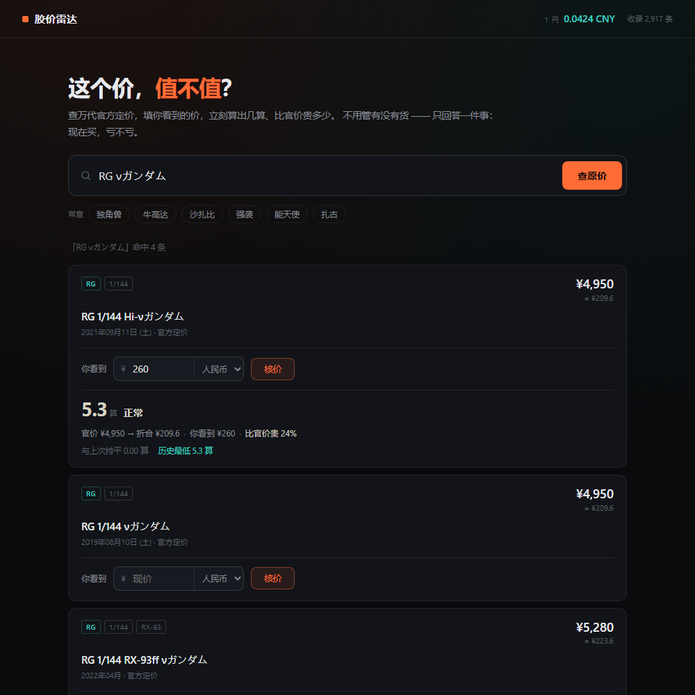

# 胶价雷达 · jiaojia

你看到一个价，想知道它值不值。这个工具查**万代官方定价**，按实时汇率折算，算出「几算」，告诉你买贵了没有。



## 它只干一件事

```
搜机型 → 官方定价 ¥4,950 円（≈ ¥209.6）
       → 填你看到的价：¥260
       → 5.25 算 · 正常 · 比官价贵 24% · 不着急可以再等等
```

不管有没有货、不管日本卖多少 —— 那些跟「这个价合不合理」没关系。

## 收录了什么

从万代官网（bandai-hobby.net）抓的**通贩官方定价**：

| 系列 | 条数 |
|---|---|
| HG | 1000+ |
| MG | 370+ |
| RG | 110+ |
| PG | 35 |

每条含：日文原名、等级、比例、机体编号、官方定价（円）、发卖日、官网链接。

数据来自官网 sitemap 的 5,559 个商品页，逐页解析 `価格` 字段。跑一次约 20 分钟，脚本在 `scripts/scrape-bandai.mjs`。

## 「几算」怎么算

```
几算 = 人民币价 ÷ (日元官价 ÷ 100)
```

RG ν高达官价 4,950 円，卖 260 元 → 260 ÷ 49.5 = **5.25 算**。

按当前汇率折合约 209.6 元（4.23 算），这是理论下限。

| 区间 | 含义 | 建议 |
|---|---|---|
| ≤ 4.5 算 | 好价 | 可以下手 |
| 4.5 – 5.5 | 正常 | 不着急可以等 |
| 5.5 – 6.5 | 偏高 | 非急用建议再等 |
| > 6.5 | 很贵 | 除非绝版，别买 |

## 快速开始

### 方式一：单文件（不装任何东西）

双击 `jiaojia.html`，用浏览器打开即可。

2917 条官价全部内嵌在这一个文件里，426KB。
不需要 Node、不需要联网（汇率连不上就用内置值）、不需要服务器。
搜索和核价全在浏览器本地跑，你的出价不会上传到任何地方。

重新打包（官价更新后）：

```bash
node scripts/build-standalone.mjs
```

### 方式二：本地服务

需要 Node 18+，零依赖。

```bash
git clone https://github.com/Onikamicpj/jiaojia.git
cd jiaojia
node src/cli.js serve
```

打开 http://localhost:5173 ，搜「独角兽」或「RX-93」。

### 刷新官方定价

```bash
node scripts/scrape-bandai.mjs              # 全量（约 20 分钟，边抓边存）
node scripts/scrape-bandai.mjs --resume     # 断点续抓
node scripts/scrape-bandai.mjs --limit=100  # 试跑
```

## 关于中文搜索

官方库是日文原名（`νガンダム` / `ユニコーン`），直接搜中文搜不到。
内置了 40 多条俗称映射（牛高达 → νガンダム、独角兽 → ユニコーン、红异端 → アストレイ レッドフレーム），
搜不到就换型号：`RX-93`、`MSN-04`、`RX-0`。

映射表在 `src/core/catalog.js` 的 `ZH_ALIAS`，欢迎 PR 补充。

## 已知取舍

- **限定版默认不显示**。Gundam Base、7-11 联名、透明电镀、PB 受注的定价体系跟通贩不同，混进来「几算」会失真。要看得加 `?all=1`。
- **SD / BB / EG 默认不显示**，不是 HG/MG/RG/PG 的常规体系。
- **官方定价会变**。万代近年调过几轮价，官网抓的是当前价，跟盒子背面印的可能不一致 —— 以官网为准。
- **没有国内价格**。拼多多、淘宝、闲鱼都要登录才有价，程序读不到，只能你填现价。

## 数据源

| 来源 | 用途 |
|---|---|
| bandai-hobby.net | 官方定价、发卖日、等级、比例 |
| frankfurter.dev（ECB） | 实时汇率 |

各站可抓性实测记录见 [docs/DATA-SOURCES.md](docs/DATA-SOURCES.md)。

## 免责

与万代无关联。价格以官网为准，仅供比价参考。

## License

MIT
