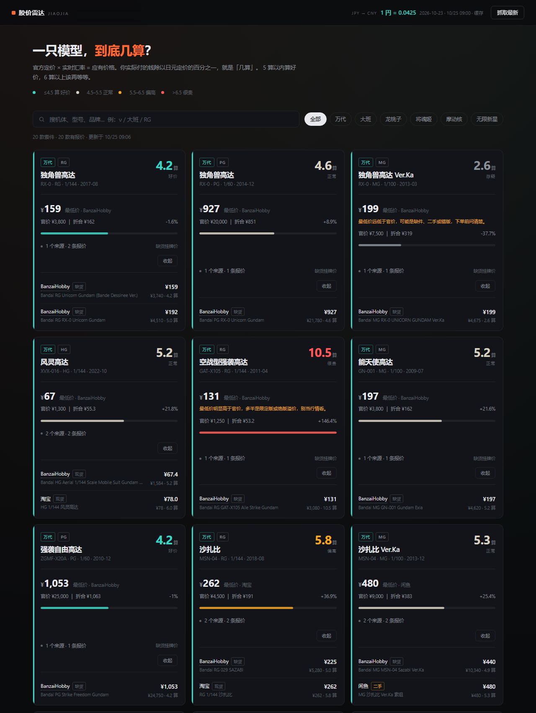

# 胶价雷达 · jiaojia

万代 / 国模 / KO 拼装模型比价。官方日元定价 + 实时汇率，一眼看出一只模型「几算」。



## 为什么做这个

买胶的时候你会同时打开一堆页面：万代官网查原价、汇率网站算人民币、淘宝看现货、闲鱼看二手、再心算一下这只到底算贵还是算便宜。

「几算」是胶圈通用的尺子 —— 官价 4500 円的 RG，卖 225 块就是 5 算。但每次都要掏出计算器算一遍，而且**没人把万代、国模、KO 放在一张表里比过**。

这个项目就干这三件事：

1. **把官价统一成人民币**，用实时汇率，不写死
2. **把「几算」算出来**，好价 / 正常 / 偏高一眼看
3. **KO 单独标注占原版官价的比例** —— 大班 PG 强袭自由卖 196，只有原版 18.4%，这个数字别处查不到

## 特性

- **实时汇率**：走 [frankfurter.dev](https://frankfurter.dev)（ECB 数据），12 小时缓存，断网自动降级到兜底汇率并标注
- **多源报价**：日本 BanzaiHobby 实时目录（约 2400 个 SKU）+ 人工录入的淘宝 / 闲鱼 / 拼多多
- **严格匹配**：等级（HG/RG/MG/PG）必须一致，且过滤限定版、透明版、电镀版、水贴、配件包 —— 比价站最怕的不是没抓到，是抓错了还当真
- **异常检测**：报价偏离官价 0.7×～2× 之外的，自动标「存疑」或「疑似限定溢价」，不参与最低价
- **零依赖**：只用 Node 内置模块，`git clone` 下来直接跑，不需要 `npm install`

## 快速开始

需要 Node 18 或更高。

```bash
git clone https://github.com/Onikamicpj/jiaojia.git
cd jiaojia

node src/cli.js collect   # 抓一次报价（约 15 秒）
node src/cli.js serve     # 打开 http://localhost:5173
```

没有网络也能跑：用内置的人工报价 CSV，汇率会降级成兜底值并明确标出来。

### 命令

| 命令 | 作用 |
|---|---|
| `node src/cli.js serve --port=5173` | 起网页 |
| `node src/cli.js collect` | 抓一遍所有套件的报价 |
| `node src/cli.js collect --kit=bandai-rg-nu` | 只抓某几款 |
| `node src/cli.js fx` | 看当前汇率 |
| `node src/cli.js check` | 校验基准库和 CSV 有没有写错 |

## 数据从哪来

| 来源 | 类型 | 覆盖 | 状态 |
|---|---|---|---|
| `data/kits.json` | 官方定价基准 | 万代 13 款 | 人工维护，欢迎 PR 修正 |
| BanzaiHobby | 日本实时报价 | 万代全系 | 自动抓取，Shopify 公开 JSON |
| `data/quotes.manual.csv` | 人工录入 | 国模 / KO / 淘宝 / 闲鱼 / 拼多多 | 手动填，**当前是示例价** |

> ⚠️ CSV 里的国内价格是**示例数据**，只为把界面跑起来，不是真实行情。真实价格请自己填，或者在淘宝/闲鱼页面确认后再录。

为什么国模和 KO 没有自动抓取？因为它们的价格只存在于淘宝 / 拼多多 / 闲鱼，这些平台没有对外开放的价格接口，反爬也很硬。硬抓属于灰色地带，所以这里选择人工维护 —— 结构上留好了位置，见下节。

## 加一款模型

编辑 `data/kits.json`：

```json
{
  "id": "bandai-rg-hi-nu",
  "brand": "bandai",
  "brandZh": "万代",
  "line": "RG",
  "scale": "1/144",
  "code": "RX-93-ν2",
  "nameZh": "Hi-ν高达",
  "nameEn": "Hi-Nu Gundam",
  "msrpJpy": 4800,
  "query": "RG 1/144 Hi-Nu Gundam",
  "matchAll": ["hi-nu"],
  "matchNone": ["1/100", "1/60"],
  "tags": ["UC"]
}
```

`matchAll` 里的 token 必须全部命中，`matchNone` 命中任一就否决。等级由 `line` 自动锁定（RG=1/144、MG=1/100、PG=1/60），比例 token 可以不写。

加完跑一下 `node src/cli.js check`，再 `collect` 就行。

## 加一个数据源

在 `src/sources/` 新建文件，导出这样的对象，然后在 `src/sources/index.js` 里注册：

```js
export const mysource = {
  id: 'mysource',
  name: '某站',
  currency: 'JPY',

  async prepare() { /* 可选：拉一次全量目录，缓存下来 */ },

  async search(kit) {
    // 返回 [{ kitId, source, sourceName, title, price, currency, available, url }]
    return [];
  }
};
```

各日本模型站的可抓性实测记录在 [docs/DATA-SOURCES.md](docs/DATA-SOURCES.md)，省得你一个个试。

## 「几算」怎么算

```
几算 = 人民币价 ÷ (日元官价 ÷ 100)
```

例：RG ν高达官价 4500 円，淘宝卖 258 元 → 258 ÷ 45 = **5.73 算**。

按当前汇率（1 円 ≈ 0.0425 元）折合 191 元，约 4.25 算 —— 这是理论下限。低于它基本只有二手或促销。

| 区间 | 含义 |
|---|---|
| ≤ 4.5 算 | 好价 |
| 4.5 – 5.5 | 正常 |
| 5.5 – 6.5 | 偏高 |
| > 6.5 | 很贵 |

KO 没有日元官价，所以不算几算，改看「占原版官价的百分比」。

## 已知限制

- **BanzaiHobby 有货率只有约 11%**，很多是缺货的历史挂牌价。缺货的仍显示，但标了「缺货挂牌价」，仅供行情参考。
- 官方定价是人工维护的，万代会调价（近年涨过几轮），发现不对请提 PR。
- 只做拼装模型，不覆盖手办 / 景品 / 扭蛋。
- 淘宝、闲鱼的价格靠人工，不会自动更新。

## 免责

本项目与万代、摩动核、无限新星、大班等任何厂商无关联。所有价格仅供参考，购买前请以商家页面为准。抓取仅使用各站公开接口，遵守 robots.txt，请勿用于商业用途。

## License

MIT
