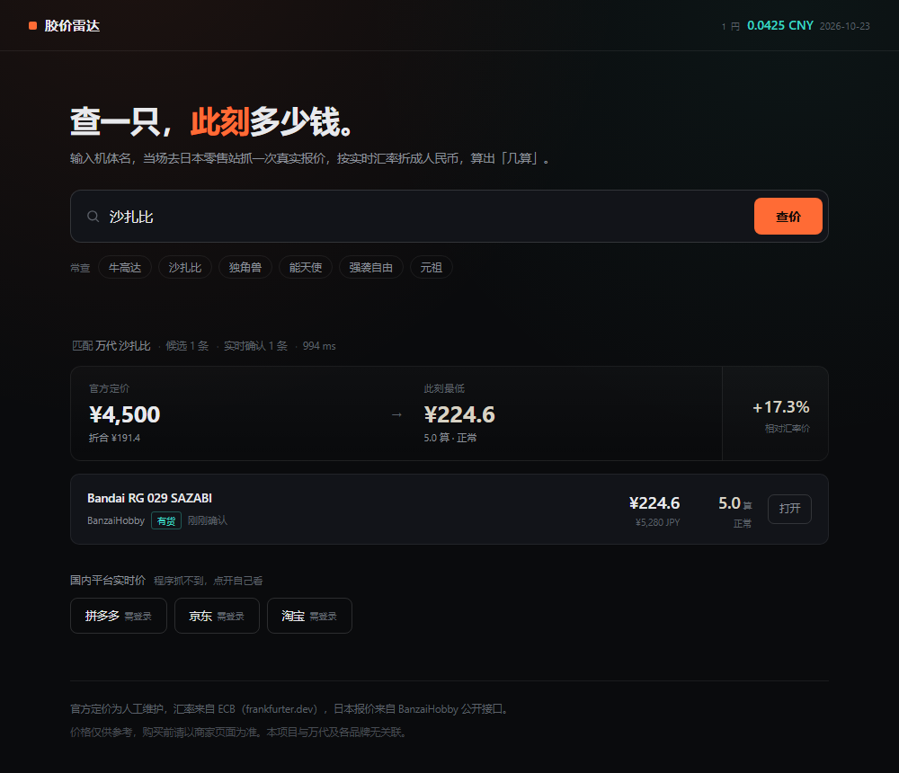

# 胶价雷达 · jiaojia

输入一只模型，当场查它**此刻**在日本卖多少钱，按实时汇率折成人民币，算出「几算」。



## 它不是数据库

市面上同类工具大多是「先爬一遍存起来，再让你查」——数据放进那天就开始过期。

这个项目反过来：**你输入什么，它当场去抓什么**。

```
输入「牛高达」
  ↓ 命中基准库 → 翻成 RG 1/144 Nu Gundam
  ↓ 在目录里找候选 → 过滤限定版 / 透明版 / 别的等级
  ↓ 逐条调单品接口确认此刻价格和库存
输出：¥210.6 · 4.7 算 · 有货 · 798ms
```

没有预存行情，没有人工编的价格。页面上的每个数字都是刚才那次请求抓回来的。

## 「几算」是什么

胶圈判断贵贱的通用尺子：

```
几算 = 人民币价 ÷ (日元官价 ÷ 100)
```

RG ν高达官价 4500 円，卖 210 元 → 210 ÷ 45 = **4.7 算**。

| 区间 | 含义 |
|---|---|
| ≤ 4.5 算 | 好价 |
| 4.5 – 5.5 | 正常 |
| 5.5 – 6.5 | 偏高 |
| > 6.5 | 很贵 |

按当前汇率（1 円 ≈ 0.0425 元），官价折合 191.4 元 ≈ 4.25 算，这是理论下限。

## 核价：这个价值不值

搜到机型后点「核价」，把你看到的价格填进去：

```
你看到 ¥230
  ↓
5.1 算 · 正常
官方定价 ¥4,500 円 → 折合 ¥191.4 · 比官价贵 20.1%
比上次涨了 0.55 算（+12.1%）  历史最低 4.6 算（¥205）
```

每次核价都会存一条快照到 `data/cache/history.json`。
攒几次之后，「涨了还是降了」就有据可依；第一次核价只能告诉你相对官价的贵贱。

## 快速开始

需要 Node 18+，零依赖，不用 `npm install`。

```bash
git clone https://github.com/Onikamicpj/jiaojia.git
cd jiaojia
node src/cli.js serve
```

打开 http://localhost:5173 ，输入「牛高达」。

首次查询会拉一次商品目录（约 15 秒，之后缓存在本地，6 小时内复用），
之后每次查询都在 1 秒内。

## 数据从哪来

| 来源 | 用途 | 实时性 |
|---|---|---|
| BanzaiHobby 商品目录 | 找货、过滤 | 6 小时缓存一次 |
| BanzaiHobby 单品接口 | **确认此刻价格与库存** | 每次查询实时 |
| frankfurter.dev（ECB） | 汇率 | 12 小时缓存，断网有兜底 |
| `data/kits.json` | 官方日元定价、别名 | 人工维护 |

## 为什么查不到拼多多

这是本项目最需要说清楚的一件事。我实测过五种方法：

| 尝试 | 结果 |
|---|---|
| 拼多多 H5 搜索页 | 48KB 的 React 空壳，`price` 出现 0 次 |
| 拼多多数据接口 | `error_code: 40001`，缺 `anti_content` 风控签名（对方 JS 实时算的） |
| 拼多多 + 真实浏览器渲染 | 渲染完只剩「登录」两个字 |
| 京东搜索 / 商品页 / 价格接口 | 302 跳转、跳登录页、空响应 |
| 什么值得买 / Bing 兜底 | 202 拦截、垃圾结果 |

**国内电商全部要求登录态**，没有登录一律返回拦截页。搜索引擎能搜到的价格来自导购文章，可能已经是几个月前的报价——拿它当实时价，比不显示更误导。

所以产品里的处理是：给三个平台的一键跳转按钮，点开就是它自己的实时搜索结果。

## 加一款模型

编辑 `data/kits.json`：

```json
{
  "id": "bandai-rg-hi-nu",
  "brand": "bandai",
  "brandZh": "万代",
  "line": "RG",
  "scale": "1/144",
  "code": "RX-93-ν2",
  "nameZh": "Hi-ν高达",
  "nameEn": "Hi-Nu Gundam",
  "aliases": ["海牛", "hi-nu"],
  "msrpJpy": 4800,
  "query": "RG Hi-Nu Gundam",
  "matchAll": ["hi-nu"],
  "matchNone": ["1/100", "1/60"]
}
```

`aliases` 是中文俗称，没它搜「海牛」搜不到东西。
`query` 是送去日本站检索的英文词。

加完跑 `node src/cli.js check` 校验。

## 加一个数据源

在 `src/sources/` 新建文件，导出：

```js
export const mysource = {
  id: 'mysource',
  name: '某站',
  async prepare() {},
  async search(kit) { return []; }
};
```

各日本模型站的可抓性实测记录在 [docs/DATA-SOURCES.md](docs/DATA-SOURCES.md) —— AmiAmi、骏河屋、1999.co.jp、HLJ 我都试过了，省得你再踩一遍。

## 已知限制

- **只有万代**。国模和 KO 在日本没有货源，查不到；界面会提示你去国内平台看。
- **限定版被过滤**。透明版、电镀版、Gundam Base 限定、一番赏不参与比价——它们的价格不代表行情。
- **官方定价人工维护**，万代会调价，发现不对请提 PR。
- 日本站的通贩新品经常缺货，此时会显示「缺货」而不是隐藏，因为挂牌价仍有参考价值。

## 免责

与万代、摩动核、无限新星、大班等任何厂商无关联。价格仅供参考，购买前请以商家页面为准。
抓取仅使用公开接口并控制频率，请勿用于商业用途。

## License

MIT
